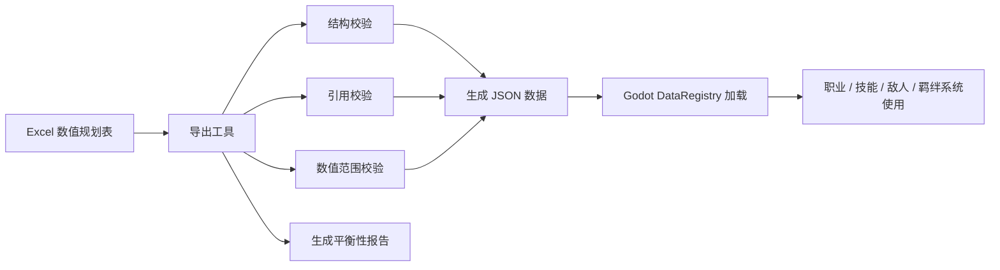

# 数值规划流程设计方案

> 适用项目：九重天堂  
> 目标：用 Excel 作为数值策划工作台，用导出的 JSON/CSV 作为 Godot 运行时数据源。

---

## 一、设计目标

当前项目中的职业、技能、敌人、羁绊等数值主要散落在 GDScript 代码中。随着后期角色、敌人、技能和状态效果数量增加，继续硬编码会带来以下问题：

- 数值修改需要进入代码文件，策划迭代成本高。
- 技能、职业、敌人之间的 ID 引用难以统一校验。
- DOT、HOT、Buff、Debuff、叠层、持续区域等效果难以用固定字段表达。
- 无法方便地做 DPS、EHP、治疗量、关卡缩放等平衡性预览。
- 大量数据变更不容易生成差异报告。

因此建议建立一套“Excel 规划、工具校验、JSON 导出、Godot 加载”的数值工作流。

核心目标：

1. Excel 负责数值设计、公式计算、人工审阅。
2. 导出工具负责读取 Excel、校验引用、生成运行时数据。
3. Godot 只读取稳定格式的数据文件，不直接依赖 `.xlsx`。
4. 技能与状态效果逐步改为数据驱动，减少 `UnitBase` 中的硬编码分支。
5. 保留当前 Godot 场景树、信号、Manager 架构，只把数值来源迁移到数据层。

---

## 二、整体流程



建议流程：

1. 策划在 Excel 中维护所有可调数值。
2. 点击脚本或运行命令导出数据。
3. 工具检查重复 ID、缺失引用、非法数值和公式结果。
4. 校验通过后生成 `game/data/*.json`。
5. Godot 启动或热重载时由 `DataRegistry` 统一读取。
6. 平衡报告输出到 `doc` 或 `tools/reports`，供人工审阅。

---

## 三、Excel 工作簿结构

建议使用一个主工作簿，例如：

```text
tools/balance/numerical_design.xlsx
```

工作表规划：

| Sheet | 作用 | 导出 |
|---|---|---|
| `Config` | 全局参数，如等级上限、DP 上限、金币倍率 | 是 |
| `Classes` | 英雄/职业基础模板 | 是 |
| `Skills` | 技能主表 | 是 |
| `SkillEffects` | 技能效果子表，支持多段效果 | 是 |
| `StatusEffects` | DOT、HOT、Buff、Debuff、护盾、控制等持续状态 | 是 |
| `Enemies` | 敌人基础模板 | 是 |
| `EnemyScaling` | 楼层、精英、Boss 数值缩放 | 是 |
| `Synergies` | 羁绊定义 | 是 |
| `SynergyEffects` | 羁绊效果明细 | 是 |
| `Waves` | 波次与敌人组合配置 | 是 |
| `Validation` | Excel 内部校验提示 | 否 |
| `Sim` | DPS、EHP、治疗量、技能循环预估 | 否 |
| `Changelog` | 重要数值调整记录 | 否 |

设计原则：

- 第一行固定为字段名。
- 每张导出表必须有唯一 ID 字段。
- 废弃数据使用 `enabled = FALSE`，不要直接删除，便于追踪历史。
- 显示文本和运行时数值尽量分列，避免解析描述文本。
- 引用字段统一使用 ID，而不是中文名。

---

## 四、核心表结构

### 4.1 Config

用于维护全局常量。

| key | value | type | note |
|---|---:|---|---|
| max_character_level | 20 | int | 角色最大等级 |
| max_deployment_points | 100 | int | DP 上限 |
| initial_deployment_points | 20 | int | 战斗初始 DP |
| dp_regen_per_second | 1.0 | float | 战斗中 DP 回复 |
| retreat_refund_ratio | 0.5 | float | 撤退返还比例 |

导出示例：

```json
{
  "max_character_level": 20,
  "max_deployment_points": 100,
  "initial_deployment_points": 20,
  "dp_regen_per_second": 1.0,
  "retreat_refund_ratio": 0.5
}
```

### 4.2 Classes

用于维护英雄和职业模板。

| class_id | enabled | name | class_group | subclass_id | stat_tags | alignment_tags | deploy_cost | hp | atk | def | attack_speed | move_speed | attack_mode | target_priority | attack_range | search_range | skill_ids |
|---|---|---|---|---|---|---|---:|---:|---:|---:|---:|---:|---|---|---:|---:|---|
| warrior | TRUE | 战士 | nation_a | fighter | STR,VIT | lawful | 8 | 200 | 18 | 12 | 1.2 | 2.0 | melee_single | nearest | 1.5 | 5.0 | shield_wall,taunt |

字段说明：

| 字段 | 说明 |
|---|---|
| `class_id` | 职业唯一 ID |
| `class_group` | 主羁绊或国家归属 |
| `stat_tags` | 六维小羁绊标签，逗号分隔 |
| `alignment_tags` | 阵营标签，逗号分隔 |
| `attack_mode` | 普攻模式，如单体、远程、治疗、范围 |
| `target_priority` | 索敌优先级 |
| `skill_ids` | 该职业可用技能 ID 列表 |

后续可扩展字段：

- `rarity`
- `role`
- `unlock_condition`
- `growth_hp`
- `growth_atk`
- `growth_def`
- `stance_defense_bonus`
- `stance_range_bonus`

### 4.3 Skills

技能主表只描述技能的基础信息，不直接塞入所有效果细节。

| skill_id | enabled | name | description | cooldown | dp_cost | cast_type | target_rule | icon | tags |
|---|---|---|---|---:|---:|---|---|---|---|
| fireball | TRUE | 火球术 | 对目标区域造成伤害并附加燃烧 | 8.0 | 10 | instant | enemy_radius | fireball.png | magic,aoe |

字段说明：

| 字段 | 说明 |
|---|---|
| `skill_id` | 技能唯一 ID |
| `cooldown` | 冷却时间 |
| `dp_cost` | 施放消耗 |
| `cast_type` | 立即、引导、被动、光环等 |
| `target_rule` | 目标选择规则 |
| `tags` | 技能标签，用于羁绊或装备触发 |

### 4.4 SkillEffects

技能效果子表用于支持一个技能包含多段效果。

| skill_id | effect_order | effect_type | target_filter | value_type | value | radius | duration | tick_interval | status_id | stack |
|---|---:|---|---|---|---:|---:|---:|---:|---|---:|
| fireball | 1 | damage | enemy_radius | atk_ratio | 2.0 | 2.0 | 0 | 0 | | 0 |
| fireball | 2 | apply_status | enemy_radius | fixed | 0 | 2.0 | 5.0 | 1.0 | burn | 1 |
| heal_wave | 1 | heal | ally_radius | atk_ratio | 1.5 | 2.0 | 0 | 0 | | 0 |

效果类型建议：

| effect_type | 说明 |
|---|---|
| `damage` | 造成伤害 |
| `heal` | 立即治疗 |
| `apply_status` | 添加持续状态 |
| `remove_status` | 移除状态 |
| `shield` | 添加护盾 |
| `summon` | 召唤单位 |
| `resource_change` | 改变 DP、金币等资源 |
| `force_target` | 强制索敌或嘲讽 |
| `move` | 位移、冲锋、拉拽 |

目标筛选建议：

| target_filter | 说明 |
|---|---|
| `current_target` | 当前目标 |
| `self` | 自身 |
| `enemy_radius` | 范围内敌人 |
| `ally_radius` | 范围内友方 |
| `lowest_hp_enemy` | 最低生命敌人 |
| `lowest_hp_ally` | 最低生命友方 |
| `farthest_enemy` | 最远敌人 |
| `random_enemy` | 随机敌人 |

### 4.5 StatusEffects

用于 DOT、HOT、Buff、Debuff、控制、护盾等持续效果。

| status_id | enabled | name | status_type | stack_rule | max_stack | duration | tick_interval | tick_effect_type | tick_value_type | tick_value | modifier_stat | modifier_value |
|---|---|---|---|---|---:|---:|---:|---|---|---:|---|---:|
| burn | TRUE | 燃烧 | dot | refresh | 1 | 5.0 | 1.0 | damage | atk_ratio | 0.2 | | 0 |
| regen | TRUE | 再生 | hot | stack | 3 | 6.0 | 1.0 | heal | atk_ratio | 0.15 | | 0 |
| armor_break | TRUE | 破甲 | debuff | refresh | 1 | 4.0 | 0 | none | fixed | 0 | defense_multiplier | 0.7 |

叠加规则建议：

| stack_rule | 说明 |
|---|---|
| `refresh` | 重新施加时刷新持续时间 |
| `stack` | 可叠层，层数不超过 `max_stack` |
| `extend` | 重新施加时延长持续时间 |
| `replace_stronger` | 只保留更强的一层 |
| `independent` | 多个来源独立存在 |

### 4.6 Enemies

| enemy_id | enabled | name | enemy_type | hp | atk | def | attack_speed | move_speed | attack_range | search_range | skills | tags |
|---|---|---|---|---:|---:|---:|---:|---:|---:|---:|---|---|
| goblin | TRUE | 哥布林 | melee | 60 | 8 | 2 | 1.4 | 2.8 | 1.2 | 5.0 | | small,fast |
| dragon | TRUE | 巨龙 | boss | 500 | 40 | 15 | 0.8 | 1.2 | 3.0 | 8.0 | dragon_breath | boss,large |

### 4.7 EnemyScaling

| scaling_id | floor | enemy_type | hp_multiplier | atk_multiplier | def_multiplier | reward_multiplier |
|---|---:|---|---:|---:|---:|---:|
| normal_f1 | 1 | normal | 1.0 | 1.0 | 1.0 | 1.0 |
| elite_f1 | 1 | elite | 1.5 | 1.4 | 1.2 | 1.5 |
| boss_f1 | 1 | boss | 2.0 | 1.8 | 1.5 | 2.0 |

### 4.8 Synergies

| synergy_id | enabled | name | short_name | type | tag | thresholds | description |
|---|---|---|---|---|---|---|---|
| stat_str | TRUE | 力量 | 力 | minor_stat | STR | 2,3 | 提升攻击力，三人后获得破甲 |

### 4.9 SynergyEffects

| synergy_id | min_tier | effect_type | stat | base | per_layer | max_value |
|---|---:|---|---|---:|---:|---:|
| stat_str | 2 | modifier | attack_multiplier | 1.15 | 0.0038 | 5.0 |
| stat_str | 3 | modifier | armor_pierce | 0.10 | 0.00025 | 0.35 |

### 4.10 Waves

| wave_id | battle_id | wave_index | enemy_id | count | spawn_group | delay | scaling_id |
|---|---|---:|---|---:|---|---:|---|
| f1_b1_w1_goblin | floor1_battle1 | 1 | goblin | 6 | right_edge | 0.0 | normal_f1 |
| f1_b1_w2_skeleton | floor1_battle1 | 2 | skeleton | 4 | right_edge | 2.0 | normal_f1 |

---

## 五、导出数据结构

建议导出到：

```text
game/data/
├── config.json
├── classes.json
├── skills.json
├── status_effects.json
├── enemies.json
├── enemy_scaling.json
├── synergies.json
└── waves.json
```

`skills.json` 示例：

```json
{
  "fireball": {
    "skill_id": "fireball",
    "name": "火球术",
    "description": "对目标区域造成伤害并附加燃烧",
    "cooldown": 8.0,
    "dp_cost": 10,
    "cast_type": "instant",
    "target_rule": "enemy_radius",
    "effects": [
      {
        "effect_type": "damage",
        "target_filter": "enemy_radius",
        "value_type": "atk_ratio",
        "value": 2.0,
        "radius": 2.0
      },
      {
        "effect_type": "apply_status",
        "target_filter": "enemy_radius",
        "radius": 2.0,
        "status_id": "burn",
        "duration": 5.0,
        "stack": 1
      }
    ]
  }
}
```

`status_effects.json` 示例：

```json
{
  "burn": {
    "status_id": "burn",
    "name": "燃烧",
    "status_type": "dot",
    "stack_rule": "refresh",
    "max_stack": 1,
    "duration": 5.0,
    "tick_interval": 1.0,
    "tick_effect_type": "damage",
    "tick_value_type": "atk_ratio",
    "tick_value": 0.2
  }
}
```

---

## 六、导出工具设计

推荐使用 Python 编写导出工具：

```text
tools/
└── balance/
    ├── numerical_design.xlsx
    ├── export_balance.py
    ├── schemas/
    │   ├── classes.schema.json
    │   ├── skills.schema.json
    │   └── enemies.schema.json
    └── reports/
        ├── validation_report.md
        └── balance_report.html
```

推荐依赖：

- `openpyxl`：读取 Excel。
- `jsonschema`：可选，用于 JSON Schema 校验。
- `jinja2`：可选，用于生成 HTML 报告。

命令示例：

```powershell
python tools/balance/export_balance.py `
  --input tools/balance/numerical_design.xlsx `
  --output game/data `
  --report tools/balance/reports
```

导出工具职责：

1. 读取 Excel 指定 Sheet。
2. 跳过 `enabled = FALSE` 的记录。
3. 转换字段类型。
4. 解析逗号分隔 ID 列表。
5. 合并主表与子表，例如 `Skills + SkillEffects`。
6. 执行校验。
7. 输出 JSON。
8. 生成校验报告和平衡报告。

---

## 七、校验规则

### 7.1 通用校验

| 规则 | 示例 |
|---|---|
| ID 不允许为空 | `skill_id`、`class_id` 必填 |
| ID 不允许重复 | 两个技能不能都叫 `fireball` |
| ID 格式统一 | 推荐小写英文、数字、下划线 |
| 启用字段合法 | `enabled` 只能是 TRUE/FALSE |
| 数值类型正确 | HP、ATK、CD 必须可转为数字 |

### 7.2 引用校验

| 来源字段 | 目标表 |
|---|---|
| `Classes.skill_ids` | `Skills.skill_id` |
| `SkillEffects.status_id` | `StatusEffects.status_id` |
| `Waves.enemy_id` | `Enemies.enemy_id` |
| `Waves.scaling_id` | `EnemyScaling.scaling_id` |
| `SynergyEffects.synergy_id` | `Synergies.synergy_id` |

### 7.3 数值范围校验

| 字段 | 规则 |
|---|---|
| `hp` | 必须大于 0 |
| `atk` | 必须大于等于 0 |
| `def` | 必须大于等于 0 |
| `attack_speed` | 必须大于 0 |
| `cooldown` | 必须大于等于 0 |
| `dp_cost` | 必须大于等于 0 |
| `duration` | 必须大于等于 0 |
| `tick_interval` | DOT/HOT 状态必须大于 0 |
| `max_stack` | 叠层状态必须大于等于 1 |

### 7.4 平衡性提示

这类不阻塞导出，但应在报告中提示：

- 部署费用过低但 EHP/DPS 过高。
- 技能总伤害明显高于同冷却技能均值。
- DOT 总伤害超过立即伤害过多。
- 治疗技能 HPS 明显超过敌方平均 DPS。
- Boss 血量导致预计战斗时间过短或过长。
- 低楼层敌人攻击力对新手队伍造成秒杀风险。

---

## 八、平衡性计算指标

建议在 `Sim` 表或导出报告中计算以下指标。

### 8.1 英雄指标

| 指标 | 公式思路 |
|---|---|
| 普攻 DPS | `atk * attack_speed` |
| 有效生命 EHP | `hp * (1 + def / 防御系数)` |
| 部署效率 | `(DPS + EHP 权重) / deploy_cost` |
| 技能循环 DPS | `技能总伤害 / cooldown` |
| 治疗 HPS | `技能治疗量 / cooldown` |

### 8.2 敌人指标

| 指标 | 公式思路 |
|---|---|
| 敌人威胁值 | `DPS * 生存时间修正` |
| 波次总威胁 | `sum(敌人威胁值 * 数量)` |
| 预计击杀时间 | `敌方总 EHP / 玩家估算 DPS` |
| 预计承伤压力 | `敌方总 DPS / 玩家总 EHP` |

### 8.3 技能指标

| 指标 | 公式思路 |
|---|---|
| 单次价值 | 伤害、治疗、护盾、控制折算 |
| 每秒价值 | `单次价值 / cooldown` |
| 每 DP 价值 | `单次价值 / dp_cost` |
| DOT 总量 | `tick_value * tick_count * stack` |
| HOT 总量 | `tick_value * tick_count * stack` |

---

## 九、Godot 接入方案

### 9.1 新增 DataRegistry

建议新增：

```text
game/scripts/data/data_registry.gd
```

作为 Autoload：

```text
DataRegistry="*res://scripts/data/data_registry.gd"
```

职责：

- 启动时加载 `res://data/*.json`。
- 提供统一查询 API。
- 开发模式下支持热重载。
- 输出缺失 ID 的明确错误。

建议 API：

```gdscript
DataRegistry.get_config("max_character_level")
DataRegistry.get_class("warrior")
DataRegistry.get_skill("fireball")
DataRegistry.get_enemy("goblin")
DataRegistry.get_status_effect("burn")
DataRegistry.get_synergy("stat_str")
DataRegistry.get_wave("floor1_battle1")
```

### 9.2 与现有代码的迁移关系

当前硬编码位置：

| 当前文件 | 建议迁移方向 |
|---|---|
| `scripts/classes/class_definitions.gd` | 改为读取 `DataRegistry.get_class()` |
| `scripts/skills/skill_data.gd` | 改为读取 `DataRegistry.get_skill()` |
| `scripts/units/enemy_unit.gd` | 敌人模板改为读取 `DataRegistry.get_enemy()` |
| `scripts/synergy/synergy_manager.gd` | 羁绊定义改为读取 `DataRegistry.get_synergy()` |

迁移原则：

1. 不一次性删除旧代码。
2. 先让 `DataRegistry` 与旧工厂并存。
3. 新数据能覆盖旧数据，但旧数据作为 fallback。
4. 确认稳定后，再逐步移除硬编码注册表。

---

## 十、技能与状态系统改造建议

当前 `UnitBase._execute_skill()` 适合简单技能，但不适合后期几十种技能和 DOT/HOT。

建议新增：

```text
game/scripts/combat/
├── effect_executor.gd
├── status_effect_instance.gd
└── status_effect_manager.gd
```

### 10.1 EffectExecutor

职责：

- 根据技能数据执行 `effects` 数组。
- 根据 `target_filter` 找目标。
- 根据 `effect_type` 分发伤害、治疗、状态、护盾等逻辑。
- 统一处理暴击、增伤、减伤、吸血、护甲穿透等修正。

### 10.2 StatusEffectManager

职责：

- 挂在单位身上，或由全局战斗系统统一管理。
- 维护当前单位身上的状态列表。
- 每帧或固定 tick 更新持续状态。
- 处理 DOT/HOT tick。
- 处理叠层、刷新、替换、过期。
- 状态变化时通知单位刷新属性。

### 10.3 UnitBase 瘦身

`UnitBase` 保留：

- 生命值、死亡、血条、选中、节点位置。
- `take_damage()`、`heal()` 作为最终入口。
- `use_skill()` 调用 `EffectExecutor`。

`UnitBase` 不再直接维护大量技能分支。

---

## 十一、推荐落地阶段

### 阶段 1：基础导出

目标：先把硬编码最多、变化最频繁的数据迁出。

范围：

- `Classes`
- `Skills`
- `Enemies`

产物：

- `numerical_design.xlsx`
- `export_balance.py`
- `classes.json`
- `skills.json`
- `enemies.json`
- 基础校验报告

### 阶段 2：Godot 数据注册表

目标：Godot 能统一读取导出数据。

范围：

- 新增 `DataRegistry`
- `ClassDefinitions` 支持从 JSON 构建 `ClassTemplate`
- `SkillData` 支持从 JSON 查询
- `EnemyUnit` 支持从 JSON 创建模板

### 阶段 3：技能效果数据驱动

目标：支持一个技能多个效果。

范围：

- 新增 `SkillEffects`
- 新增 `EffectExecutor`
- 把 `_execute_skill()` 的硬编码分支迁移到效果执行器

### 阶段 4：状态效果系统

目标：支持 DOT、HOT、Buff、Debuff、叠层。

范围：

- 新增 `StatusEffects`
- 新增 `StatusEffectManager`
- 支持状态图标、持续时间、tick、叠层

### 阶段 5：平衡报告和模拟

目标：提升数值调试效率。

范围：

- 输出 DPS/EHP/HPS 报告
- 输出技能价值报告
- 输出波次威胁报告
- 支持导出前后差异对比

---

## 十二、风险与注意事项

### 12.1 不建议 Godot 直接读取 Excel

原因：

- Godot 运行时读取 `.xlsx` 需要额外库或复杂解析。
- 打包后文件访问和兼容性更麻烦。
- Excel 公式、格式、隐藏行列会增加不确定性。
- JSON/CSV 更稳定、更轻量、更适合版本管理。

### 12.2 不要让 Excel 变成逻辑脚本

Excel 应该负责数值和配置，不应该承载复杂条件逻辑。复杂逻辑仍应放在 Godot 代码中，通过 `effect_type`、`target_filter`、`status_type` 等枚举来驱动。

### 12.3 字段要克制

不要一开始设计过多字段。建议先覆盖当前需要：

- 角色基础属性
- 敌人基础属性
- 技能基础信息
- 多段技能效果
- DOT/HOT/Buff 状态

后续再加入召唤、投射物、装备、天赋、词缀等系统。

### 12.4 报错要面向策划

错误信息必须精确到：

```text
Sheet: SkillEffects
Row: 12
Column: status_id
Error: 引用了不存在的状态 burnning，是否想写 burn？
```

这样才能真正提升工作效率。

---

## 十三、建议目录结构

```text
game/
├── data/
│   ├── config.json
│   ├── classes.json
│   ├── skills.json
│   ├── status_effects.json
│   ├── enemies.json
│   ├── enemy_scaling.json
│   ├── synergies.json
│   └── waves.json
├── scripts/
│   ├── data/
│   │   └── data_registry.gd
│   └── combat/
│       ├── effect_executor.gd
│       ├── status_effect_instance.gd
│       └── status_effect_manager.gd
tools/
└── balance/
    ├── numerical_design.xlsx
    ├── export_balance.py
    ├── schemas/
    └── reports/
```

---

## 十四、最终建议

本项目后期会有几十种角色、几十种敌人和几十种技能，并且包含群伤、DOT、HOT、Buff、Debuff 等持续效果。当前架构可以支撑几十个单位规模的战斗，但不适合继续把数值和技能逻辑全部硬编码在脚本中。

推荐采用：

```text
Excel 数值规划
  → Python 导出与校验
  → JSON 运行时数据
  → Godot DataRegistry 统一读取
  → EffectExecutor / StatusEffectManager 执行复杂技能和状态
```

这样可以保留当前 Godot 场景树和信号架构的开发效率，同时让数值设计、技能扩展和平衡性验证进入可维护流程。
